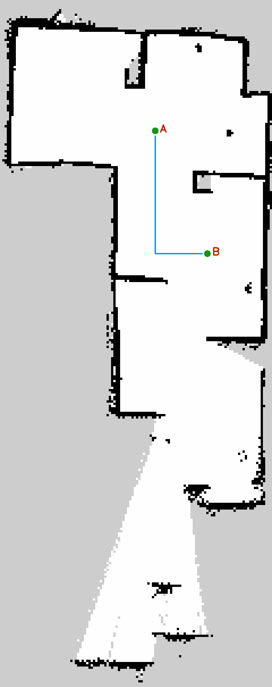
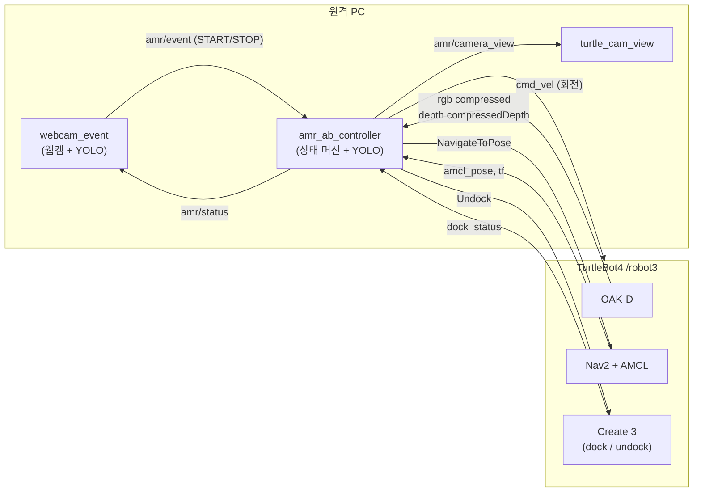
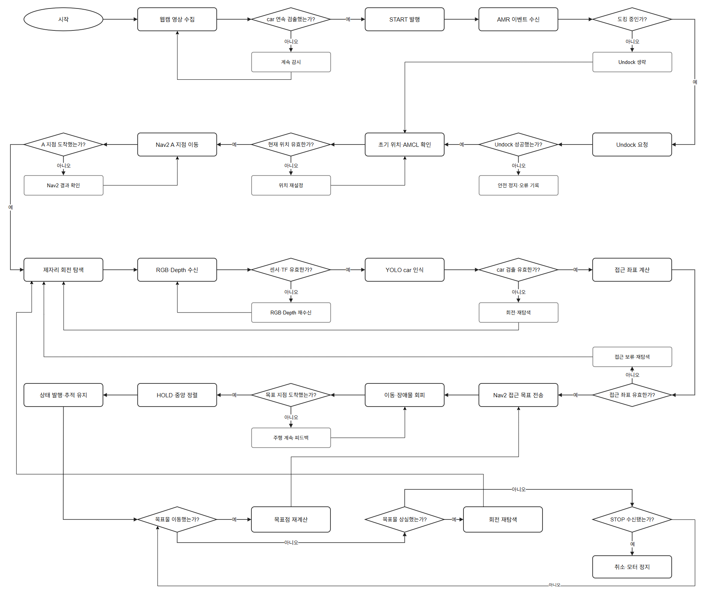

<div align="center">

# 🚗 TurtleBot4 차량 탐색·접근 AMR

**웹캠이 차를 보면 로봇이 출동한다.**
TurtleBot4가 도크에서 나와 지정 구역으로 이동하고, OAK-D + YOLOv8로 차량을 찾아 0.8 m 앞까지 접근한 뒤 따라갑니다.


[개요](#-개요) · [시스템 구조](#-시스템-구조) · [설치](#-설치) · [실행](#-실행) · [노드와 토픽](#-노드와-토픽) · [모델](#-yolo-모델) · [결과](#-결과와-배운-점) · [문제 해결](#-문제-해결)

</div>

---

## 📌 개요

| 항목 | 내용 |
|---|---|
| 로봇 | TurtleBot4 (Create 3 + Raspberry Pi 4, 네임스페이스 `/robot3`) |
| 센서 | OAK-D (RGB + 스테레오 depth), RPLIDAR, 외장 USB 웹캠 (PC) |
| 플랫폼 | ROS 2 Jazzy, Ubuntu 24.04, Nav2, AMCL |
| 인식 | YOLOv8 (`car` / `dummy` 2클래스), ByteTrack 추적 |
| 패키지 | `amr_ab_control` (ament_python) |
| 프로젝트 노트 | [Notion](https://app.notion.com/p/C-3-PROJECT-414ce25f3edf809c82a2fd13798d6a38?source=copy_link) |

### 주요 기능

- **이벤트 기반 출동:** PC 웹캠이 `car`를 5프레임 연속 감지하면 `START` 이벤트를 보냅니다.
- **도크 출발:** Undock 액션 → AMCL 위치 재확인 → 탐색 지점 A로 Nav2 이동
- **회전 탐색:** A에서 제자리 회전(`cmd_vel`)하며 차량을 찾습니다.
- **안전한 접근:** depth로 차량의 map 좌표를 구하고, 지도에서 안전한 0.8 m 앞 지점을 골라 접근합니다.
- **추적:** 정지 후에도 차를 화면 중앙에 유지하고, 차가 움직이면 따라갑니다. 화면에서 사라지면 나간 쪽으로 회전합니다.
- **오인식 방지:** `dummy`는 접근 대상에서 제외, `car` 박스가 `dummy`와 30% 이상 겹치면 무시, 신뢰도 0.7 미만 무시, 2프레임 연속 확인

<div align="center">
<br>
<sub>지도 위 탐색 지점과 경로 프리뷰 (<code>ab_nav_only --preview</code>)</sub>
</div>

---

## 🧭 시스템 구조



### 동작 흐름

웹캠 START부터 Undock, 탐색, 접근, 추적까지 컨트롤러의 전체 흐름입니다.

<p align="center">
  <a href="docs/images/amr_flow.png"></a>
</p>

<details>
<summary>컨트롤러 상태 이름으로 보기 (<code>amr/status</code>에 표시되는 값)</summary>

| 상태 | 의미 |
|---|---|
| `IDLE` | START 대기 |
| `WAIT_DOCK_STATUS` | 도크 위인지 확인 중 |
| `UNDOCKING` | Undock 액션 실행 중 |
| `LOCALIZING` | AMCL 위치와 map TF 확인 중 |
| `NAV_SEARCH` / `SEARCH` | 탐색 지점 A로 이동 중 |
| `SCAN` | 제자리 회전 탐색 |
| `APPROACH` | 차량 0.8 m 앞으로 접근 중 (차가 움직이면 재계획) |
| `HOLD` | 정지 후 차를 화면 중앙에 유지 |
| `STOPPED` / `FAULT` | STOP 수신 / 오류. `RESET`으로 `IDLE` 복귀 |

</details>

원본: [`docs/AMR.drawio`](docs/AMR.drawio). 노드·토픽까지 적힌 단계별 상세 흐름도(전체 시나리오, 검출 파이프라인, 접근·추적, 지도 안전 검사, 노드·토픽 명세)는 [`docs/AMR_flowchart.drawio`](docs/AMR_flowchart.drawio)에 있습니다([draw.io](https://app.diagrams.net)에서 열기).

---

## 📁 저장소 구조

```
.
├── amr_ab_control/               ROS 2 패키지 (메인)
│   ├── amr_ab_control/
│   │   ├── amr_ab_controller.py        메인 노드: 파라미터, 이벤트, 상태 머신(tick)
│   │   ├── docking.py                  도크 상태, Undock, 초기 위치·AMCL 확인
│   │   ├── navigation.py               Nav2 이동·취소, 탐색 지점 이동, 제자리 회전, 접근
│   │   ├── perception.py               RGB/depth 동기화, YOLO 감지·추적, 감지 화면
│   │   ├── amr_ab_controller_patrol.py 이전 버전: A/B 순찰
│   │   ├── approach_core.py            접근 목표 계산, 지도 안전 검사 (ROS 비의존)
│   │   ├── webcam_event.py             웹캠 car 감지 → START 이벤트
│   │   ├── turtle_cam_view.py          로봇 카메라 + YOLO 화면
│   │   ├── ab_nav_only.py              경로만 따로 시험 / 지도 프리뷰
│   │   ├── bag_to_mp4.py               rosbag 영상 → mp4
│   │   └── paths.py                    지도, 모델 경로
│   ├── maps/minimap.{yaml,pgm}   실습장 지도
│   ├── models/*.pt               YOLO 가중치
│   ├── scripts/record_test.sh    시험 rosbag 녹화
│   └── test/                     오프라인 유닛 테스트 (11개)
├── yolo/                         단독 실행 YOLO + depth 거리 측정 노드 (초기 실험용)
├── dataset/                      Roboflow 데이터셋 (YOLOv8 형식)
├── docs/                         구성도, 흐름도, 코드 개선 노트
└── archive/                      이전 버전 (B/C 순찰)
```

---

## 🛠 설치

### 요구 사항

- Ubuntu 24.04 + ROS 2 Jazzy (원격 PC)
- TurtleBot4 패키지: `ros-jazzy-turtlebot4-navigation`, `ros-jazzy-turtlebot4-viz`
- Python: `ultralytics`, `lap` ([`requirements.txt`](requirements.txt))

### 빌드

```bash
mkdir -p ~/rokey_ws/src && cd ~/rokey_ws/src
git clone -b release/final https://github.com/kswoo02/Mini.git mini
pip install -r mini/requirements.txt "numpy<2"
cd ~/rokey_ws
rosdep install --from-paths src --ignore-src -y
colcon build --symlink-install --packages-select amr_ab_control
source install/setup.bash
```

colcon이 하위 폴더의 `amr_ab_control/package.xml`을 자동으로 찾습니다. 지도와 모델도 패키지와 함께 설치되므로 경로를 따로 설정할 필요가 없습니다.

> [!TIP]
> `--symlink-install`로 빌드했으므로 `.py` 파일만 고쳤을 때는 다시 빌드하지 않아도 됩니다. 파일을 추가하거나 `setup.py`를 고쳤을 때만 다시 빌드하세요.

### 로봇 쪽 설정 확인

| 항목 | 확인 방법 |
|---|---|
| 네임스페이스 | `turtlebot4-setup`의 `ROBOT_NAMESPACE`가 `/robot3`인지 |
| PC ↔ 로봇 통신 | 같은 `ROS_DOMAIN_ID`, Discovery Server 사용 시 PC에서 `configure_discovery.sh` 실행 후 `ros2 daemon stop; ros2 daemon start` |
| OAK-D 깊이 | OAK-D 설정이 RGBD 파이프라인인지(`i_pipeline_type: RGBD`). 기본 설정은 RGB 미리보기만 발행합니다. |
| 시간 동기화 | `timedatectl status`로 PC와 로봇 시각이 맞는지 확인 |

---

## ▶ 실행

터미널마다 `source ~/rokey_ws/install/setup.bash`를 먼저 실행하고, 아래 순서대로 띄웁니다.

| # | 명령 | 다음 단계로 넘어가는 시점 |
|---|---|---|
| ① | `ros2 launch turtlebot4_navigation localization.launch.py namespace:=/robot3 map:=$(ros2 pkg prefix amr_ab_control)/share/amr_ab_control/maps/minimap.yaml` | `Managed nodes are active` |
| ② | `ros2 launch turtlebot4_navigation nav2.launch.py namespace:=/robot3` | `Managed nodes are active` |
| ③ | `ros2 launch turtlebot4_viz view_navigation.launch.py namespace:=/robot3` | RViz에서 **2D Pose Estimate** 지정 |
| ④ | `ros2 run amr_ab_control amr_ab_controller --execute` | `controller ready` |
| ⑤ | `ros2 run amr_ab_control turtle_cam_view` | (선택) 로봇 카메라 화면 |
| ⑥ | `ros2 run amr_ab_control record_test.sh <메모>` | (선택) 녹화, Ctrl+C로 저장 |
| ⑦ | `ros2 run amr_ab_control webcam_event` | 화면에 `ROBOT: IDLE`이 보이면 차를 웹캠 앞에 |

> [!WARNING]
> `--execute`를 빼면 dry-run이라 로봇이 움직이지 않습니다. 또 `STOP`은 작업 취소일 뿐 **비상정지가 아닙니다.** 실기 시험 때는 항상 사람이 로봇 가까이에서 지켜보세요.

### 수동 제어

```bash
ros2 topic pub --once /robot3/amr/event std_msgs/msg/String "{data: START}"
ros2 topic pub --once /robot3/amr/event std_msgs/msg/String "{data: STOP}"
ros2 topic pub --once /robot3/amr/event std_msgs/msg/String "{data: RESET}"
ros2 topic echo /robot3/amr/status
```

### 다른 로봇에서 실행

```bash
ros2 run amr_ab_control amr_ab_controller --execute --namespace /robot1
ros2 run amr_ab_control webcam_event --namespace /robot1
ros2 run amr_ab_control turtle_cam_view --namespace /robot1
NS=/robot1 ros2 run amr_ab_control record_test.sh
```

### 녹화 영상 변환

```bash
ros2 run amr_ab_control bag_to_mp4 ~/rokey_ws/bags/test_YYYYMMDD_HHMMSS_메모
```

---

## 🔌 노드와 토픽

아래 토픽 이름은 노드 네임스페이스(`/robot3`) 기준의 상대 이름입니다.

### `amr_ab_controller`

| 구분 | 이름 | 타입 | 설명 |
|---|---|---|---|
| Sub | `amr/event` | `std_msgs/String` | `START` / `STOP` / `RESET` |
| Sub | `oakd/rgb/image_raw/compressed` | `sensor_msgs/CompressedImage` | YOLO 입력 |
| Sub | `oakd/stereo/image_raw/compressedDepth` | `sensor_msgs/CompressedImage` | 거리 계산 (RGB와 시각 ±0.2 s로 매칭) |
| Sub | `oakd/rgb/camera_info` | `sensor_msgs/CameraInfo` | 픽셀 → 3D 변환 |
| Sub | `amcl_pose` | `geometry_msgs/PoseWithCovarianceStamped` | 위치 확인 |
| Sub | `dock_status` | `irobot_create_msgs/DockStatus` | 도크 위인지 판단 |
| Sub | `clicked_point` | `geometry_msgs/PointStamped` | RViz Publish Point로 탐색 지점 변경 |
| Pub | `amr/status` | `std_msgs/String` (JSON) | 현재 상태, 1 Hz |
| Pub | `amr/target_info` | `std_msgs/String` (JSON) | 추적 중인 차량 정보 |
| Pub | `amr/camera_view/compressed` | `sensor_msgs/CompressedImage` | YOLO 박스가 그려진 화면 |
| Pub | `cmd_vel` | `geometry_msgs/TwistStamped` | 제자리 회전 |
| Pub | `initialpose` | `geometry_msgs/PoseWithCovarianceStamped` | 초기 위치 (파라미터 지정 시) |
| Action | `navigate_to_pose` | `nav2_msgs/NavigateToPose` | 이동, 접근 |
| Action | `undock` | `irobot_create_msgs/Undock` | 도크 출발 |

### `webcam_event`

| 구분 | 이름 | 타입 | 설명 |
|---|---|---|---|
| Pub | `amr/event` | `std_msgs/String` | car 5프레임 연속 감지 시 `START` (30 s 쿨다운) |
| Sub | `amr/status` | `std_msgs/String` | 로봇 상태를 웹캠 화면에 표시 |
| Pub | `amr/webcam_view/compressed` | `sensor_msgs/CompressedImage` | 녹화용 화면 |

옵션: `--camera`(기본 2), `--model`, `--conf`(0.7), `--frames`(5), `--cooldown`(30), `--namespace`

### 주요 파라미터 (`amr_ab_controller`)

| 파라미터 | 기본값 | 설명 |
|---|---|---|
| `standoff_m` | `0.80` | 차량 중심에서 접근 목표까지 거리 (m) |
| `search_x`, `search_y` | `-2.15`, `2.20` | 회전 탐색 지점 A (map 좌표) |
| `min_confidence` | `0.7` | car로 인정할 최소 신뢰도 |
| `confirm_frames` | `2` | 연속 감지 프레임 수 |
| `dummy_overlap` | `0.3` | dummy와 이 비율 이상 겹치는 car 박스는 무시 |
| `detect_on_way` | `false` | A로 가는 도중에 본 차에도 접근할지 |
| `scan_speed` | `0.5` | 회전 탐색 속도 (rad/s, 한 바퀴 약 13 s) |
| `track_gain` / `track_deadband_deg` | `1.5` / `6.0` | 정지 중 화면 중앙 유지 게인 / 데드밴드 |
| `lost_turn_after_s` | `1.0` | 이 시간 안 보이면 나간 쪽으로 회전 |
| `replan_distance_m` | `0.45` | 차가 이만큼 움직이면 접근 목표 재계산 |
| `post_undock_localize_s` | `20.0` | 언독 후 AMCL 위치를 기다리는 최대 시간 |
| `model_path` | `models/oakd_best1.pt` | OAK-D용 YOLO 가중치 |

```bash
ros2 run amr_ab_control amr_ab_controller --execute --ros-args -p search_x:=-1.0 -p search_y:=-0.5
```

---

## 🧠 YOLO 모델

### 데이터셋

| 항목 | 내용 |
|---|---|
| 출처 | Roboflow [mini_project_rokey](https://universe.roboflow.com/1213-qgwp3/mini_project_rokey) (직접 촬영, 라벨링) |
| 클래스 | `car`, `dummy` |
| 이미지 수 | 204장 (train 143 / valid 41 / test 20) |
| 전처리, 증강 | 없음 (Roboflow 내보내기 기준) |
| 형식 | YOLOv8 (`data.yaml`) |
| 라이선스 | CC BY 4.0 |

### 가중치

| 파일 | 용도 | 비고 |
|---|---|---|
| `amr_ab_control/models/oakd_best1.pt` | 로봇 OAK-D 감지 (기본값) | 704×704 OAK-D 영상 |
| `amr_ab_control/models/webcam_car_dummy_aug.pt` | 웹캠 START 감지 (기본값) | 증강 데이터로 학습 |
| `amr_ab_control/models/nano_colab.pt` | 웹캠용 후보 | Colab에서 학습한 YOLOv8n |
| `yolo/models/best.pt` | 단독 노드 `yolo/yolo_detector.py` 용 | 초기 실험 |

### 재학습

```bash
unzip dataset/mini_project_rokey.yolov8.zip -d dataset/rokey
yolo detect train data=dataset/rokey/data.yaml model=yolov8n.pt imgsz=640 epochs=100
yolo detect val   model=runs/detect/train/weights/best.pt data=dataset/rokey/data.yaml split=test
```

학습이 끝나면 `runs/detect/train/weights/best.pt`를 `amr_ab_control/models/`에 복사하고 `model_path` 파라미터로 지정합니다.

---

## 📊 결과와 배운 점

| 시험 항목 | 결과 |
|---|---|
| 오프라인 유닛 테스트 (`approach_core`) | 11 / 11 통과 |
| 웹캠 START → Undock → A 이동 → 회전 탐색 → 접근 | 전체 흐름 동작 |
| 실제 car 신뢰도 | 0.88 ~ 0.96 |
| 오탐 신뢰도 (검은 SUV 등) | 최대 약 0.51 → 기준값 0.7로 분리 |
| 정지 거리 | 목표 0.80 m, Nav2 도착 오차로 실제 약 +0.25 m |

실기에서 부딪히며 바꾼 것들입니다.

- **WiFi 대역폭:** OAK-D raw 영상은 WiFi로 0.4 fps밖에 안 나와서, RGB는 JPEG 압축 토픽, depth는 `compressedDepth`를 쓰도록 바꿨습니다. 화면 표시용 영상도 PC 안에서 다시 발행해 WiFi 부담을 늘리지 않았습니다.
- **RGB/depth 동기화:** 두 토픽의 최신 프레임을 그냥 쓰면 주행 중 거리가 어긋나서, RGB 시각에 가장 가까운 depth(±0.2 s)를 골라 씁니다.
- **depth 샘플링:** 박스 중심 한 점은 차체 틈으로 배경을 집는 경우가 있어, 박스 중앙 영역의 중앙값을 씁니다. ([개선 노트](docs/yolo_node_개선점.md))
- **오인식:** 신뢰도 기준을 올리고, 2프레임 연속 확인과 ByteTrack ID 추적, dummy 겹침 필터를 더했습니다.
- **추적 흔들림:** YOLO가 한두 프레임 놓칠 때 로봇이 흔들려서, 놓친 뒤 1초를 기다린 다음 회전하도록 했습니다.

---

## 🧯 문제 해결

<details>
<summary><b>Undock 후 <code>No fresh AMCL estimate after undock</code>으로 멈춤</b></summary>

도크 위에서 라이다가 꺼져 있으면 AMCL이 위치를 갱신하지 못합니다. Jazzy에서는 `power_saver`가 기본으로 켜져 있어 도킹 중 라이다와 OAK-D를 끕니다.

- `ros2 topic hz /robot3/scan`으로 스캔이 나오는지 확인
- 필요하면 로봇의 `turtlebot4.yaml`에서 `power_saver: false`로 바꾸고 `turtlebot4-service-restart`
- RViz에서 도크 위 로봇 위치와 방향으로 2D Pose Estimate를 다시 찍고 `RESET` → `START`
</details>

<details>
<summary><b>OAK-D 토픽이 안 보이거나 depth가 안 옴</b></summary>

- `ros2 topic list | grep oakd`로 `rgb/image_raw/compressed`와 `stereo/image_raw/compressedDepth`가 있는지 확인
- 기본 OAK-D 설정은 RGB 미리보기만 발행합니다. RGBD 파이프라인으로 설정되어 있는지 확인하세요.
- 언독 후 OAK-D가 다시 켜지지 않는 경우가 있습니다(power_saver). 위 항목과 같은 방법으로 해결합니다.
</details>

<details>
<summary><b>로봇 토픽이 PC에서 안 보임</b></summary>

- PC와 로봇의 `ROS_DOMAIN_ID`, RMW 구현(`RMW_IMPLEMENTATION`)이 같은지 확인
- Discovery Server를 쓰면 `ROS_DISCOVERY_SERVER` 설정 후 `ros2 daemon stop; ros2 daemon start`
- tf가 안 보이면 네임스페이스 리맵을 확인하세요. 컨트롤러는 `/tf`를 `/robot3/tf`로 자동 리맵합니다.
</details>

<details>
<summary><b><code>_ARRAY_API not found</code> / cv_bridge import 오류</b></summary>

ultralytics를 설치하면서 NumPy 2가 함께 깔려 apt의 cv_bridge와 충돌하는 경우입니다.

```bash
pip install "numpy<2"
```
</details>

<details>
<summary><b>Nav2 목표가 거부되거나 로봇이 엉뚱한 곳으로 감</b></summary>

- ①, ②에서 `Managed nodes are active`가 떴는지 확인
- RViz에서 2D Pose Estimate를 실제 위치에 맞게 찍었는지, 레이저 스캔이 지도 벽과 겹치는지 확인
- `timedatectl status`로 PC와 로봇 시각 차이를 확인 (tf 시간 오류 원인)
</details>

<details>
<summary><b>웹캠이 안 열림 (<code>/dev/videoN 열기 실패</code>)</b></summary>

`v4l2-ctl --list-devices`로 번호를 확인하고 `--camera N`으로 지정합니다. 노트북 내장 카메라가 0번이라 기본값은 2입니다.
</details>

---

## ⚠ 한계와 향후 과제

- 안전 검사는 접근 목표점만 확인합니다. Nav2가 실제로 지나가는 경로 전체를 보장하지는 않습니다.
- 구역 통제용 Nav2 Keepout Filter는 구현하지 않았습니다.
- RGB-depth 정렬은 robot3의 OAK-D(704×704, RGB 정렬 depth) 기준으로 확인했습니다. 다른 로봇은 다시 확인해야 합니다.
- 지도 밖이나 미지 영역에 있는 대상을 걸러내는 기능은 남은 과제입니다.

## 🧪 테스트

```bash
cd ~/rokey_ws/src/mini/amr_ab_control && python3 -m pytest -q test
ros2 run amr_ab_control ab_nav_only --preview /tmp/ab_preview.png   # 지도 경로 프리뷰 (로봇은 움직이지 않음)
```

시험 계획과 요구사항 추적표는 [`SYSTEM_REQUIREMENTS.md`](amr_ab_control/SYSTEM_REQUIREMENTS.md)에 있습니다.

## 📄 라이선스와 출처

- 데이터셋: [mini_project_rokey](https://universe.roboflow.com/1213-qgwp3/mini_project_rokey), CC BY 4.0
- [Ultralytics YOLOv8](https://github.com/ultralytics/ultralytics)은 AGPL-3.0입니다. 이 저장소를 공개 배포할 때는 AGPL-3.0 조건을 따라야 합니다.
- [TurtleBot4](https://github.com/turtlebot/turtlebot4), [Nav2](https://github.com/ros-navigation/navigation2)
